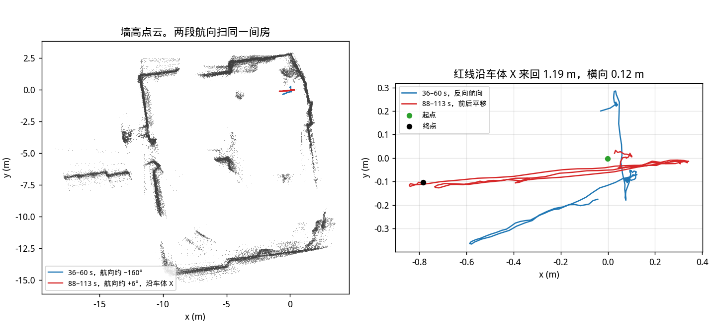
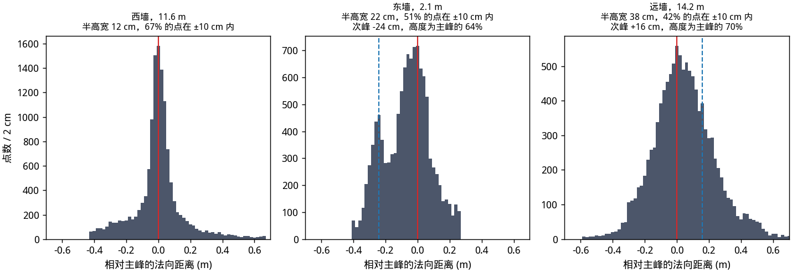
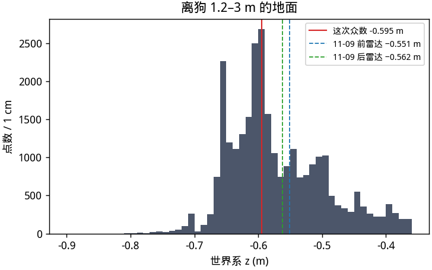

# 外参 xyz 核对（2026-11-10 在线建图）

平移仍用 CAD，不改。

| 雷达 | x, y, z (m) |
|---|---|
| 前 Airy | 0.32028, 0, −0.013 |
| 后 Airy | −0.32028, 0, −0.013 |

两点相距 0.64056 m，沿车体 X。y 都是 0，z 都是 −0.013 m。旋转是 2026-11-09 的地面拟合，这次不动。

这次能看出来的是前后雷达的**相对**平移。两台一起偏一个相同的向量，会被里程计吃进车体位置，地图上看不出来。

## 用的数据

会话 `~/ligo_sessions/20261110_150245`，室内，GNSS 关，113 秒，1126 个位姿。

`m20_online.bag` 只录到约 60 秒（1.0 GB，594 帧）。15:03:50 磁盘不足 1 GB，`rosbag` 自己停了。16:02 为腾磁盘，这个文件删了，11:35 那份在回收站里的包也一并清了。`scans.pcd` 不存前后标记，只留 xyz。下面的墙和地面是今天用 `scans.pcd` 和 `traj_xyz.txt` 重算的。包里前后雷达的格子距离，用的是删包之前那次读包的结果。

前后平移、并且两段航向扫过同一间房的，是最后这段，不在包里：

| 时间 | 在做什么 | 航向 | 位移 |
|---|---|---|---|
| 0–18 s | 站着 | 约 0° | 包络 0.20 m × 0.01 m |
| 36–60 s | 转过身之后 | 约 −158° 到 −174° | 在 1 m 见方里挪 |
| 92–113 s | 沿车体 X 来回 | +4.9° 到 +6.5° | 沿车体 X 1.19 m，横向约 0.12 m |

92–113 秒的位移和车体 +X 的点积是 −1.00，是在倒着和正着走同一条线，不是转弯。104 秒之后航向停在 +5.0° 到 +6.4°。两段航向相差大约 170°。前雷达在 +6° 时看见的东、西墙，后雷达在 −160° 时也看得见。相对平移要是错了 δ，这两段打到同一面墙上会错开大约 2|δ|，远近墙一样大。

## 墙

点只用高度 0.30 m 到 1.20 m，躲开地面和天花板。每面墙沿法向做 2 cm 直方图，主峰半高宽是这条墙有多厚。

| 墙 | 离狗 | 点数 | 半高宽 | ±10 cm 以内 | 次峰 |
|---|---:|---:|---:|---:|---|
| 西墙，法向沿世界 X | 11.6 m | 13550 | 12 cm | 67% | 没有过主峰 25% 的次峰 |
| 东墙，法向也沿世界 X | 2.1 m | 11756 | 22 cm | 51% | 内侧 24 cm，高度为主峰的 64% |
| 远墙，法向沿世界 Y | 14.2 m | 11510 | 38 cm | 42% | 外侧 16 cm，高度为主峰的 70% |

西墙和东墙法向相同。一个固定的相对 x 误差会把这两面墙错开同样的距离。西墙在 11.6 m 处是一条墙，半高宽 12 cm，67% 的点落在 ±10 cm 里。东墙内侧 24 cm 那条没有出现在西墙上，所以它不是这个 x。它可以是墙前的一道真实结构。

远墙的 16 cm 是 y 方向上能看到的肩。这条墙本身半高宽就有 38 cm，16 cm 分不出「要改 y」的那一截。按世界 y 直接做直方图，会把这面斜墙在不同 x 上的位置当成两条相距大约 1 m 的平行墙。沿法向量，没有这 1 m。

3.7° 是两次转弯的差：先 −158.4°，再 +162.1°。包里 22–40 秒里程计 −156.3°，陀螺 z 积分 −155.9°，狗确实转了这么多，不是航向估错了 3.7°。3.7° 在 14 m 处的 0.9 m，没有画到这面墙上。

12 cm 的半高宽是两段航向叠在一起之后的厚度。相对 x 若有 |δ|，错开约 2|δ|。这条厚度把 |δx| 圈在大约 6 cm 以内。同一趟转弯里的前后格子（下面）把系统性的那部分压到一个 5 cm 格子里。6 cm 以下这次分不出来，不够改 CAD 的 0.32028 m。

## 地面，看 z

离狗 1.2–3 m、z 在 −0.90 m 到 −0.35 m 的点，28453 个。众数 −0.595 m，半高宽 5 cm，52% 的点在 ±5 cm 内。位姿的 z 中位数是 −0.003 m。

2026-11-09 静止时，前雷达地面 −0.551 m，后雷达 −0.562 m，高差 1.1 cm。这次众数比那两片低大约 4 cm，落在这趟 pitch 摆动里（pitch 标准差 2.5°，2 m 处大约 9 cm）。地面是一个峰，没有两片地板。z 仍以那 1.1 cm 为准，−0.013 m 不改。

## 包里的前后雷达

删包之前读过 `m20_online.bag`。点已经在车体坐标系，强度 30 是前雷达，220 是后雷达。第一帧 101536 点，前 53069，后 48467。两路时间戳都跨 0.100 秒，中位差 1.8 ms。

同一个 2° 方位角里，前后要各有至少 6 个点才算打到同一条射线上。全包 0 个这样的方位角。两个半球朝相反方向，站着的时候后雷达格子离前雷达中位 2.9 m，10 cm 以内是 0%。这段对不了平移。

22–40 秒狗在转，转完之后两路都扫过同一片墙。后雷达的 5 cm 格子到最近的前雷达格子：

| | 中位 | 90% 分位 | 99% 分位 | ≤10 cm | ≤20 cm |
|---|---:|---:|---:|---:|---:|
| 0–18 s 站立 | 2.89 m | 11.9 m | 16.5 m | 0% | 0% |
| 22–40 s 转弯 | 0 | 0.29 m | 0.81 m | 79.6% | 86.5% |

中位是 0，系统性的相对平移不超过一个 5 cm 格子。90% 分位 29 cm 出在转弯：这段单帧航向 95% 分位 3.6°，4 m 处大约 25 cm。92–113 秒航向稳，包已经停了，这段的前后颜色没有留下。

## 结论

xyz 保持现在的 CAD。

- 相对 x：11.6 m 的西墙两段航向合成一条，半高宽 12 cm。转弯时前后格子中位距离 0。
- 相对 y：远墙法向肩距 16 cm，墙自己厚 38 cm。y 仍写 0。
- 相对 z：静止高差 1.1 cm。这趟地面半高宽 5 cm，众数和静止地面差 4 cm。

东墙内侧 24 cm 的那条不是全局平移，西墙没有同样的错开。
